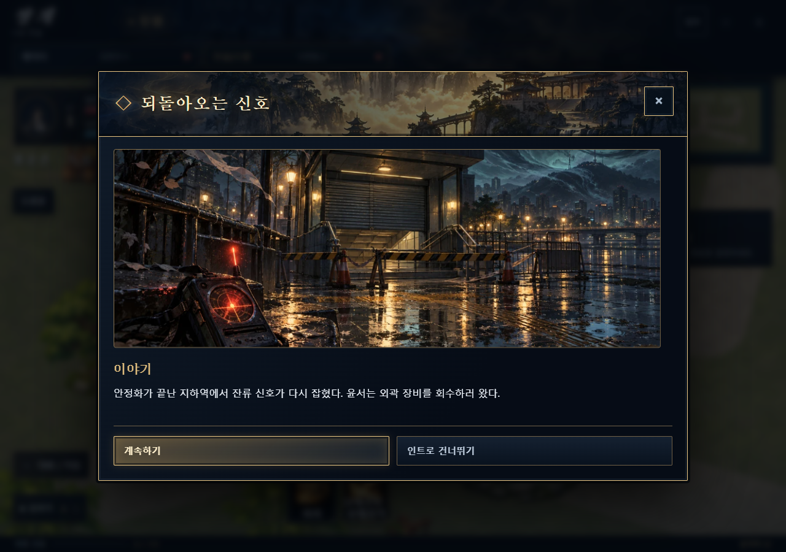
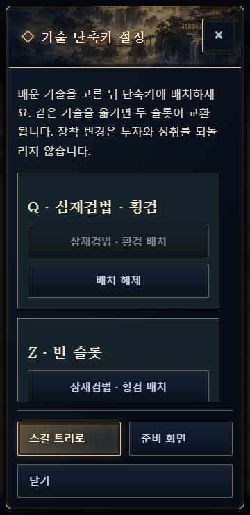

# 21. 화면과 자산 출처

갱신: 2026-10-12 (KST) · 구현 대조: `main f5a5a3b` / 게임 `v0.15.0`

[기획 시작](../README.md)

## 현행 구현 화면 — 2026-10-08 기록

아래는 v0.15.0 구현 당시 저장된 실제 화면이다. 이번 문서 작업에서 새로 캡처한 화면이 아니다.

## 자산의 현재 위치

| 자료 | 경로·역할 |
|---|---|
| 장면 이미지 | [인트로 아트 출처](../../../assets/art/intro/PROVENANCE.md), assets/art/intro의 기존 정지 이미지 |
| UI 아이콘 | [UI 자산 출처](../../../assets/ui/PROVENANCE.md) |
| 현재 아트 목록 | [manifest.json](../../../assets/art/manifest.json) |
| 이전 생성·보정·제작 이력 | [아트 제작 보관 폴더](../../archive/2026-10-12-이전문서/아트제작/) |
| 이전 시안·화면 | [시안 보관 폴더](../../archive/2026-10-12-이전문서/시안/) |
| 합성음 이전 기록 | [음향 기록](../../archive/2026-10-12-이전문서/검토기록/audio-provenance.md) — 연결 제거를 기록한 과거 문서 |

게임 자산 파일은 이동·수정하지 않았다. 현재 기획 폴더에는 읽기에 필요한 현행 화면 두 장만 복사했다. 옛 양방향 재화 아이템 아이콘·UI와 v0.14 화면은 현행 설계 시안으로 노출하지 않는다.

현재 무림 장면은 기존 이미지를 반복 활용하고 여행자도 공통 초상 표현을 사용한다. 사건별 신규 아트·전용 동작·동행 AI를 완성했다고 보고하지 않는다. 이전 제작 지시서는 재실행 명령이 아니라 출처와 작업 이력이다.
